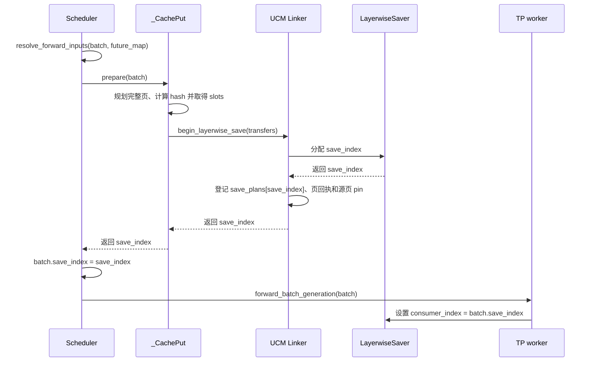
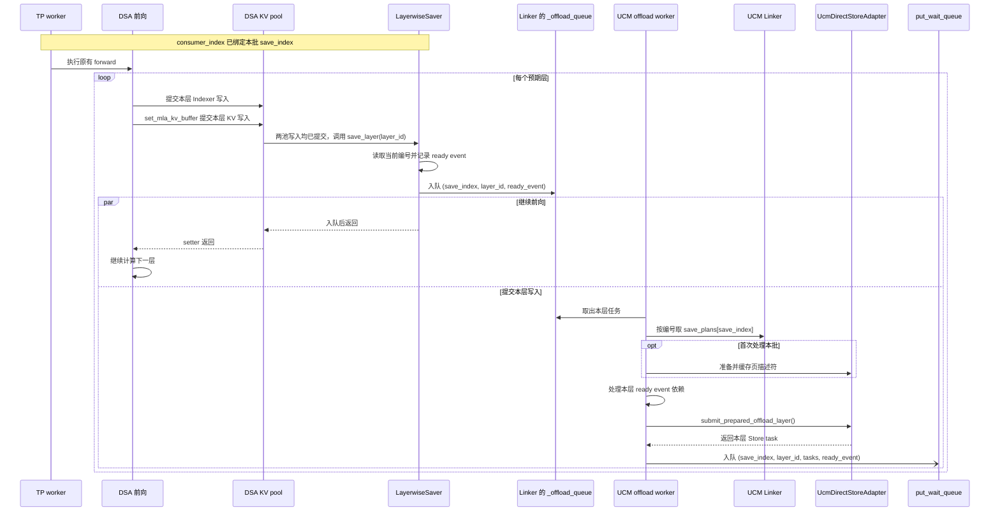
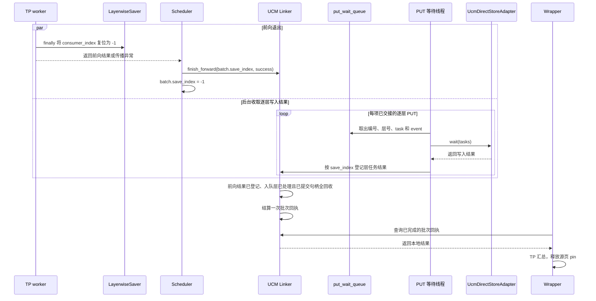
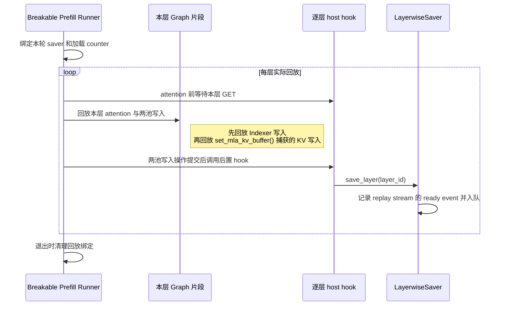

# SGLang UCM Direct Linker 逐层 PUT 设计

## 1. 目标与首版范围

给 `ucm/integration/sglang/ucm_direct_linker.py` 增加 `UcmLayerWiseLinker(UcmDirectLinker)`。DSA prefill 每产出一层的 KV 和 Indexer 数据，就允许后台提交这一层的 PUT，使它与后续层的前向计算重叠。逐层保存和普通 PUT 共享 UCM 的页 key、pool bundle、Store shard 布局和逐层 GET。通过已有 `dynamic` 后端显式选择子类。

首版以 `sglang_ori/sglang` 的 v0.5.20 基线为准。选用 `UcmLayerWiseLinker` 后，CUDA DSA 的 eager prefill 和 Breakable CUDA Graph prefill 支持逐层 PUT，包括 chunked prefill。其他批次保留原执行方式和普通 PUT，SGLang 继续决定本轮走 eager 还是 graph。逐层写使用普通 paged allocator、单机 TP、`PP=1`，支持 `attn_cp_size=1` 和启用 `interleave` 的 prefill CP。`examples/sglang_asu_mix.sh` 使用 TP=8、CP=8 的 `interleave` eager prefill。实现放在 UCM Linker、Store adapter 和 UCM 的 SGLang 接入 patch 中。

批次关联沿用 `kv_client_linker_backend_design.md` 第 8.1 节的 `save_index` 方案。Scheduler 在解析输入后创建保存计划并填写 `batch.save_index`。TP worker 读取编号并设置 saver 的 `consumer_index`。每个 Linker 持有一个 `LayerwiseSaver` 和 `save_plans`。eager setter 和 Breakable Graph 回放 hook 都只传层号调用 `save_layer(layer_id)`，后台任务用入队时记录的编号定位计划。

## 2. 类与接口

下图沿用 KvClient 类图的画法。空心三角指向父类，实线箭头表示成员引用，虚线箭头表示类型依赖。

```mermaid
classDiagram
    direction TB
    class UnifiedRadixCache {
        +linker
        +init_cache_linker(cache_linker)
        +check_hicache_events()
    }
    class UnifiedCacheLinkerWrapper {
        +cache
        +cache_linker
        +offload_nodes(node_ids)
        +take_completed_offloads(finish_count)
        +commit_completed_offloads(successes)
    }
    class UnifiedCacheLinker {
        <<abstract>>
        +lookup(rid, transfers)*
        +load(rid, transfers)*
        +start_layer_wise_loading()*
        +offload(transfers)*
    }
    class UcmDirectLinker {
        +adapter
        +pool_group
        +layer_done_counter
        -_load_queue
        -_load_thread
        -_offload_queue
        -_offload_thread
        -_offload_results
        +lookup(rid, transfers)
        +load(rid, transfers)
        +offload(transfers, session_id=None)
    }
    class UcmLayerWiseLinker {
        +layerwise_save_enabled = True
        +saver
        +save_plans
        +put_wait_queue
        +put_wait_thread
        +begin_layerwise_save(transfers)
        +finish_forward(save_index, success)
        +get_layerwise_receipts(page_keys)
        +offload(transfers)
    }
    class LayerwiseSaver {
        +producer_index
        +consumer_index
        +save_layer(layer_id)
    }
    class SavePlan {
        +page_keys
        +source_slots
        +layer_progress
        +in_flight_tasks
        +completion
    }
    class DevicePoolGroup
    class PoolTransfer
    class UcmDirectStoreAdapter {
        -_stores
        +lookup(transfers, page_keys, resume_from_pages=0)
        +prepare_load(transfers)
        +submit_offload(transfers, prerequisite_handle=0)
        +prepare_offload(transfers)
        +submit_prepared_offload_layer(prepared, logical_layer, prerequisite_handle=0)
        +check(task)
        +wait(tasks)
    }
    class UcmKVStoreBaseV1 {
        <<abstract>>
        +lookup_on_prefix(block_ids)
        +load_data(...)
        +dump_data(...)
        +wait(task)
    }

    UnifiedRadixCache "1" --> "0..1" UnifiedCacheLinkerWrapper : linker
    UnifiedCacheLinkerWrapper --> UnifiedRadixCache : cache
    UnifiedCacheLinkerWrapper --> UnifiedCacheLinker : cache_linker
    UnifiedCacheLinker <|-- UcmDirectLinker
    UcmDirectLinker <|-- UcmLayerWiseLinker
    UcmDirectLinker --> DevicePoolGroup : pool_group
    UcmDirectLinker ..> PoolTransfer : use
    UcmDirectLinker --> UcmDirectStoreAdapter : adapter
    UcmDirectStoreAdapter "1" --> "0..*" UcmKVStoreBaseV1 : _stores
    UcmLayerWiseLinker "1" --> "1" LayerwiseSaver : saver
    UcmLayerWiseLinker "1" --> "0..*" SavePlan : save_plans
```



Wrapper 的 `cache_linker` 按 `UnifiedCacheLinker` 接口调用。动态配置选择 `UcmDirectLinker` 或设计中的 `UcmLayerWiseLinker` 实例。逐层子类复用父类的 adapter、设备池、GET counter 和卸载队列。`LayerwiseSaver` 向 Linker 的 `_offload_queue` 入队，`put_wait_queue` 由逐层子类持有。图中 `prepare_offload()` 和 `submit_prepared_offload_layer()` 是拟新增的 adapter 接口。

| 位置 | 职责 |
| --- | --- |
| `UcmDirectLinker` | 提供 pool 解析、`_page_transfers()`、Store 初始化、lookup、GET 和普通 PUT。普通 PUT 的轮询、回收与 FIFO 结果发布沿用现有 offload worker |
| `UcmLayerWiseLinker` | 声明 `layerwise_save_enabled = True`。`begin_layerwise_save()` 按编号登记计划并返回 `save_index`，`finish_forward(save_index, success)` 封存本批前向结果。`get_layerwise_receipts(page_keys)` 用节点页 key 找到对应的批次回执 |
| `LayerwiseSaver` | 维护分配编号所用的 `producer_index` 和本轮前向所用的 `consumer_index`。`save_layer(layer_id)` 取当前编号，记录 ready event 并入队 |
| `save_plans[save_index]` | 保存页 key、源 slots 与 lease、预期层、已入队层、准备好的描述符、在途 task 和 `completion: Future[bool]` |
| `UcmDirectStoreAdapter` | 在 `submit_offload()` 旁增加 `prepare_offload()` 和 `submit_prepared_offload_layer(prepared, logical_layer, prerequisite_handle=0)`，复用现有 transfer 准备、`shards_by_layer` 和 Store I/O |
| SGLang 接入 patch | 在现有 Wrapper 上接入完整页规划、源页保护和批次回执消费。树侧节点的 pending 状态和解锁继续走 `offload_nodes()` / `commit_completed_offloads()` |

### 2.1 当前 `UcmDirectLinker` 持有的对象

每个 Linker 实例持有下表中的成员。Store 实例由 `adapter` 管理，普通 PUT 的 `in_flight` 是 `_offload_worker()` 内部的局部队列。 [实例初始化](../../../ucm/integration/sglang/ucm_direct_linker.py#L110) · [普通 PUT worker](../../../ucm/integration/sglang/ucm_direct_linker.py#L976)

| 实例成员 | 当前内容与用途 |
| --- | --- |
| `adapter` | `UcmDirectStoreAdapter`，管理各 pool bundle 对应的 Store，提供查询、GET、PUT 和任务等待 |
| `_kv_allocator`、`_kv_cache` | 对 SGLang 设备页 allocator 和设备 KV cache 的引用，用于解析设备池及其布局 |
| `pool_group`、`pools`、`page_size`、`num_layers` | SGLang 的设备池组、pool 名到设备池条目的映射、页大小和逻辑层数 |
| `_bundles`、`_layer_pointer_layouts` | Store 分组和片段布局，以及每个 pool 每层的显存基址、步长和片段定义，供生成传输地址 |
| `forward_stream` | 可选的前向 stream 引用，Linker 在其上记录传输依赖的前向完成事件 |
| `_pending_loads` | Scheduler 侧按请求 `rid` 暂存的 GET，等 `start_layer_wise_loading()` 将整批转入加载队列 |
| `_load_queue` | GET 工作队列。`start_layer_wise_loading()` 放入批次编号、请求映射及事件，`prefetch()` 也可放入预取任务。`_load_thread` 取任务 |
| `layer_done_counter` | `LayerWiseLoadCounter`，记录本地 GET 批次的逐层完成进度，供前向等待本层数据 |
| `_completed_loads`、`_load_results`、`_requires_load_finish` | GET 批次结果。旧接口从 `_completed_loads` 取已处理的 `rid` 列表；有显式 finish 接口时，按加载编号从 `_load_results` 取 `Future[bool]`。兼容性标志用于选择路径 |
| `_offload_queue` | PUT 工作队列。当前 `offload()` 放入一次节点卸载在本 rank 的 transfers 和 ready events，`_offload_thread` 取任务 |
| `_offload_results` | 树侧 PUT 结果队列。卸载线程按节点接纳顺序写入布尔结果，供 Wrapper 消费 |
| `_load_thread`、`_offload_thread` | 两个 Python 后台线程。前者执行 GET，后者提交、轮询并回收普通 PUT |
| `_lookup_progress` | 按请求记录上次前缀查询的页 key、transfer 标识和命中页数，支持后续续查 |
| `_tp_rank`、`_tp_size`、`_dp_rank`、`_attn_dp_rank`、`_lookup_owner`、`_dump_ranks` | 当前 rank 信息，以及共享 Cache 场景中的查询与写入分工 |
| `_closed`、`_gc_frozen` | Linker 关闭状态和一次性 GC 冻结标志 |

### 2.2 逐层 PUT 的线程与队列

当前 `UcmDirectLinker` 每个实例启动两个 Python 后台线程。load worker 处理 GET，offload worker 提交普通 PUT，用 `check()` 轮询并用 `wait()` 回收句柄。

逐层子类复用两个线程，再启动一个 `put_wait_thread`，共三个 Python 后台线程。沿用原 KvClient 的队列分工，扩展 Linker 已有的 `_offload_queue`，让普通 PUT、逐层保存和树侧 ACK 由同一个 offload worker 取任务。节点结果仍走 `_offload_results`。子类新增 saver、`save_plans` 和 `put_wait_queue`，在启动相关线程前初始化。offload worker 将已提交的逐层 task 放入 `put_wait_queue`，由 `put_wait_thread` 取出并调用 `wait()`。

## 3. 前向计划与逐层提交

| 执行路径 | 本轮保存方式 |
| --- | --- |
| CUDA DSA eager prefill | 逐层 PUT。本层两池数据写入提交后，由 KV setter 触发 |
| CUDA DSA Breakable Graph prefill | 逐层 PUT。由逐层回放 hook 触发。此 runner 因本轮形状回落到 eager 时，改由 KV setter 触发同一个计划 |
| Prefill 与 decode 同批 | 按 prefill 请求规划逐层保存，decode 请求由树侧触发普通 PUT |
| 当前已有的其他 Graph runner、纯 decode 或其他模型和布局 | 运行原有前向路径，由树侧触发普通 PUT |

Scheduler 使用 SGLang 准备的 prefill 输入识别待保存批次。具备逐层 hook 的 Breakable runner 和它的 eager 路径共用计划，运行时仍由 SGLang 原有的 Graph 判定选择实际执行路径。同一 shard 打包了 target 和 MTP draft 数据时，沿用普通 PUT，因为 target 层的 setter 执行时 draft 数据尚未写入。

### 3.1 规划本轮刚填满的页

1. `sglang_ori` 中的普通与 overlap 路径都在 `Scheduler.run_batch()` 中先执行 `resolve_forward_inputs()`，再调用 `forward_batch_generation(batch)`。UCM 在 Scheduler 解析输入后调用 `_CachePut.prepare(batch)`。它沿用树侧的 `RadixKey` 和链式页 hash，从 `req_to_token` 取得本轮刚填满页的稳定 slots 快照。跨 chunk 填满的页取整页 slots。
2. 每个请求独立展开 `_expand()`，再按 bundle 合并描述符。`_page_transfers()` 按 pool 名取映射，直接传多个请求的 `PoolTransfer(KV, ...)` 会覆盖同名项。同一页复用已有在途回执。
3. Linker 按 `save_index` 登记本批计划、回执和源页 pin。Scheduler 将编号写入 `batch.save_index`。TP worker 在前向入口读取该编号并设置 `consumer_index`。无新页时，编号为 `-1`。
4. 前向收尾时，TP worker 清除 saver 绑定，Scheduler 按 `batch.save_index` 调用 `finish_forward()`，再把 batch 上的编号恢复为 `-1`。已登记计划但前向失败时，批次按失败结算。

### 3.2 本层 ready 后提交 PUT

#### 图 A　Scheduler 准备保存计划



#### 图 B　eager setter 在本层就绪后入队



- 沿用原 KvClient 的 setter 挂点。对首版使用的 CUDA DSA eager 路径，在 Indexer 写入已提交后，`dsa_backend.forward_extend()` 调用设备池的 `set_mla_kv_buffer()`。UCM patch 在该 DSA 实例的 KV setter 完成原有写入提交后，有激活的 saver 时调用一次 `save_layer(layer.layer_id)`。用首版 backend 验证两池写入顺序。若两池分属不同 stream，记录 event 的 stream 先依赖两边写入。Breakable capture、warmup 和 replay 期间由下节的 Graph hook 管理触发。
- `interleave` prefill CP 在各 CP rank 上重组完整的 Indexer 和 MLA KV，再提交本层缓存写入。TRT-LLM FP8 分支在 `_forward_trtllm()` 内执行需要的 KV gather，然后也调用 `set_mla_kv_buffer()`，因此复用同一个 setter 挂点。
- 每批只准备一次页 key、物理页行号和地址生成器。slots 快照就绪后，通过现有的 `_page_transfers(..., for_io=True, lazy_addresses=True)` 准备描述符，提交时只生成当前层地址。slots 快照和本层数据各自遵循其事件依赖。内置 PipelineStore 已支持 prerequisite 且本层事件有可用的原生句柄时，沿用事件透传。其他路径由 offload worker 用 `event.query()` 轮询就绪，期间继续处理其他就绪工作。
- 逐层 PUT 和逐层 GET 共用现有的 `shards_by_layer`。一次提交为该层在各 bundle 中的 shard 显式传入 `[shard_index] * page_count`，每行地址沿用该 bundle 的片段顺序。内置 PipelineStore 的逐层调用复用已编码的 block IDs，传入显式 shard index。整批 `_PreparedPipelineTransfer.dump_data()` 按行号推断 shard，继续用于普通 PUT。自定义 Store 通过现有公开 `dump_data()` 接口接收相同的描述符。
- offload worker 登记层提交结果后，将 `(save_index, layer_id, tasks, ready_event)` 放入 `put_wait_queue`，继续提交后续就绪层。`tasks` 保留原生句柄和地址数组，等待线程独占消费逐层任务的句柄。单层部分提交失败时，adapter 把错误和已提交句柄交还给 offload worker，已有句柄仍由等待线程逐一回收。

#### 图 C　等待线程收取 PUT 结果并结算批次回执



- TP worker 仅在有计划时通过 `ContextVar` 暴露 Linker 持有的 saver，并在 `finally` 复位 `consumer_index`、清除上下文绑定。Scheduler 负责按原编号登记前向结果。后台始终用队列里的 `save_index` 查计划，因此前一批 PUT 未结束时，下一批也可以开始前向。
- `put_wait_thread` 调用现有 adapter 的 `wait(tasks)`，登记结果后释放地址数组和 event 引用。内置 PipelineStore 的原生 `Wait()` 在等待期间释放 GIL。offload worker 按接纳顺序推进已就绪的 ACK。

### 3.3 Breakable CUDA Graph 回放

沿用原 KvClient 第 8.6 节的逐层 host hook。参考现有 `LayerwiseKVGraphHooks` 的实现，在 `sglang_ori` 的 `PrefillCudaGraphRunner` 接入 UCM 版本。启用条件用 UCM 已选中的逐层子类和 DSA 路径。Graph 捕获时只绑定 runner 和层号。真实 replay 开始时，runner 读取 TP worker 为本轮绑定的 saver 和加载 counter，退出时在 `finally` 清理绑定。

- 在 DSA 的 `self_attn()` 边界前后登记 `eager_on_graph(True)` 的 host hook。前置 hook 在有外部 GET 时用原有 layer counter 等本层数据。捕获时沿原 DSA 路径提交 Indexer 写入，再由 `set_mla_kv_buffer()` 提交 KV 写入。这两处 GPU 操作进入 Graph 片段。真实 replay 执行捕获的写入操作，Python setter 只在原前向执行时进入。
- 本层写入片段提交后，后置 hook 调用一次 `save_layer(layer_id)`。Saver 在实际 replay stream 上记录 ready event，若有跨 stream 写入则沿用该层的依赖。capture 和 warmup 的 hook 都走空操作。eager 前向则在原 setter 提交 KV 写入后触发。两条路径提交相同的 `(save_index, layer_id, ready_event)`，后续提交队列、等待线程和回执处理共用一套实现。



### 3.4 写入归属

TP 切分布局沿用父类的分 rank block identity，各 rank 写自己命名空间里的完整本地页。TP 复制布局沿用 `_dump_ranks` 识别出的共享 Store 域，首版由域内固定 owner 提交写入。各 rank 按同一逻辑批次顺序登记计划。TP 汇总对齐 FIFO 顺序，各 rank 的 `save_index` 用于本地查表。

`interleave` CP 沿用普通 PUT 的 block identity，其中包含 `attn_cp_rank`。每个 CP rank 由自己的 attention TP 组中的写入 rank 保存该命名空间的完整本地页。TP=8、CP=8 时，各 attention TP 组宽度为 1，因此每个 CP rank 各自写入。批次回执和节点 ACK 都通过现有 attention CP 和 attention TP 组取 `MIN`。

## 4. 回执、树侧 ACK 与资源回收

**批次回执用于释放源页 pin，节点 ACK 用于更新缓存树和解除节点锁。** 一个保存批次只有一个布尔结果。任一层提交或等待失败，整批记为失败。等待线程收完已提交的句柄后，才把这个批次的 Future 设为 `False`。

| 阶段 | 完成条件与处理 | 新增与复用 |
| --- | --- | --- |
| 出具批次回执 | `finish_forward()` 封存前向结果和实际入队层，等待线程回收已提交的任务。写入 rank 在前向成功、预期层齐全、所有层写入成功后才结算 `True`。非写入 rank 汇报本地前向和层回调结果 | 新增按 `save_index` 的批次状态和等待线程，复用 Adapter 的 `wait(tasks)` |
| 释放源页 | `check_hicache_events()` 取各 TP rank 已完成的共同批次前缀并汇总结果。Wrapper 释放源页 pin，清理该批计划。IO 等待和 Future 回调在状态锁外执行 | 复用现有轮询入口，新增保存批次的 FIFO、TP 汇总和 pin 释放。原入口已有加载和节点卸载结果的同步 |
| 生成节点 ACK | `offload(transfers)` 返回 `True` 表示接纳。普通节点走原 PUT，逐层节点根据已有批次回执确认。关联批次失败时发布 `False`。每个节点只有一个 ACK，按原 FIFO 发布 | 新增节点路由和批次回执关联，复用普通 PUT 与节点结果 FIFO |
| 更新树 | `take_completed_offloads()` / `commit_completed_offloads()` 沿用原 TP 汇总。成功时标记外部副本，完成后清除节点 pending 并解锁。节点拆分继续由 `replace_pending_offload_node()` 处理 | 复用现有树侧收尾 |

### 节点为何用页 key 找批次回执

现有 Wrapper 调用 `offload(transfers)` 时只传节点 transfers，里面带有页 key 和设备索引，确认也可能晚于对应的前向。Linker 按页 key 和物理页 ID 找到保存回执。同一计划的各页共享一个 Future。批次回执完成并清理计划后，页仍在使用期间保留其归属和结果，随对应设备页释放而清理。

### 节点如何确认

1. 节点按一种方式保存。普通节点整个交给原 `UcmDirectLinker.offload()`。
2. 逐层节点查找各页关联的批次 Future 并去重。所有关联批次成功时 ACK 为 `True`，任一批次失败时 ACK 为 `False`。结果按 FIFO 发布。已提交任务由等待线程回收，源页 pin 按批次回执释放，节点持锁到 ACK 消费。

`reset()` 暂停接纳并结束未封存的计划。提交和等待线程排空逐层任务及普通 PUT 后，清理旧 ACK 和页归属索引，Wrapper 沿用 reset/close 路径释放源页和节点锁。`close()` 在排空后停止 worker，最后关闭 adapter。

## 5. Store 接口分工

沿用原 KvLinker 设计。查询走父类的 `lookup()`，由选中的 Store 判断页是否命中。直连 ASU 沿用 KvClient 的页级 EXISTS 契约。Linker 的保存回执由本次前向结果和逐层 PUT 的任务结果决定，用于树侧确认和源页回收。

## 6. SGLang 接入与 UCM patch

`sglang_ori` 的 cache registry 注册了逐层 GET counter。逐层 PUT 所需的接入挂到 UCM 已有的 `ENABLE_UCM_PATCH=1` 和 `patch/v0520` 入口。首版以该基线的以下位置接入。

| SGLang 位置 | UCM patch 动作 |
| --- | --- |
| `mem_cache/registry.py` 的 `_create_unified_radix_cache()` | 扩展现有 `v0520/registry_patch.py`。选中 `UcmLayerWiseLinker` 时为缓存实例安装 `_CachePut`，并为 TP worker 绑定对应 saver。保留现有动态加载和 GET counter 注册 |
| `managers/scheduler.py` 的 `Scheduler.run_batch()` | 为带 prefill 输入的生成批次记录保存上下文，解析输入后调用 `_CachePut.prepare()` 并填写 `batch.save_index`，收尾时登记前向结果并复位编号 |
| `managers/tp_worker.py` 的 `TpModelWorker.forward_batch_generation()` | 读取 `batch.save_index` 并绑定 saver，再调用原方法，在 `finally` 清除绑定 |
| `mem_cache/memory_pool.py` 的 DSA KV pool setter | 在选中逐层子类的 DSA 实例上包装 `set_mla_kv_buffer()`（来自 `MLATokenToKVPool`）。eager 前向中，该层 Indexer 已提交且原 setter 成功提交 KV 后，调用已激活 saver 的 `save_layer(layer.layer_id)`。Graph 捕获沿用原 setter 的 KV 写入，逐层保存由回放 hook 触发 |
| `model_executor/runner/prefill_cuda_graph_runner.py` 与 DSA 层的 `self_attn()` 边界 | 在 Graph 捕获之前安装 Breakable host hook，捕获时登记层边界，实际 replay 时绑定本轮 saver 和加载 counter。Graph 与 eager 按各自挂点触发逐层保存 |
| `mem_cache/allocator/paged.py` 的 `PagedTokenToKVPoolAllocator._release_page_ids()` | 该基线的 `free()`、`free_page_ids()` 及批量释放汇合于此。对启用逐层 PUT 的 allocator 实例记录页 pin，延迟仍被 pin 的页进入可分配列表，最后一次 unpin 时转交原释放逻辑 |
| `UnifiedCacheLinkerWrapper` 与 `UnifiedRadixCache.check_hicache_events()` | 接入页规划、pin 与回执消费。在现有 TP 汇总中增加已完成批次的 FIFO 前缀，沿用现有 load/offload ACK 和节点锁流程。基线的 cache reset 先调用 Linker reset，沿用这条路径在 allocator 清空前排空写任务 |

普通和 overlap 路径共用 Scheduler 的 `resolve_forward_inputs()` 挂点。解析输入后为本批准备一次计划，Scheduler 负责正常返回或异常时的批次结算。PD mux 的 split-prefill 使用独立的 `forward_batch_split_prefill()` 路径，由树侧触发普通 PUT。

启用逐层子类时沿用原 CUDA Graph 配置。UCM patch 从已选中的动态 Linker 配置识别逐层模式，在 Graph capture 前安装回放挂点，实际 cache registry 初始化后才绑定 Linker。单独验证 eager 时可用基线已有的 `--disable-prefill-cuda-graph`。

启动参数沿用 `--enable-unified-cache-external-linker --unified-cache-external-linker-backend dynamic`。用 `--unified-cache-external-linker-config` 选中子类并传入已有 UCM 配置。

```json
{
  "linker_module_path": "ucm.integration.sglang.ucm_direct_linker",
  "linker": "UcmLayerWiseLinker",
  "linker_extra_config": {"UCM_CONFIG_FILE": "/path/to/ucm_config.yaml"}
}
```

## 7. 实施与验收顺序

1. **Adapter**。用测试替身验证普通 PUT 和逐层 PUT 生成相同的 block ID、shard index 和片段描述符，验证准备只发生一次，并覆盖部分提交失败时已提交句柄恰好回收一次。
2. **子类与计划**。覆盖两批交错、无计划前向、前向抛错、缺层和重复层、提前 ACK、非写入 rank，以及 `reset()` 和 `close()`。普通节点沿用普通 PUT，逐层节点按批次回执发布 ACK。验证前向退出后绑定已清除，源页 lease 和节点锁在各自的安全点释放。
3. **SGLang 接入**。在 `sglang_ori` 基线上验证 eager、Breakable 实际 replay，以及同一 Breakable runner 因批次形状转入 eager 的路径。对比普通与 chunked prefill，覆盖普通和 overlap 调度，再验证单机 TP。检查 capture 和 warmup 不发出 PUT，实际回放每个预期层只提交一次。有外部 GET 的 Breakable replay 验证按层等待后再消费 KV。验证有 prefill 和 decode 请求的批次只为 prefill 请求规划逐层保存，纯 decode 和无逐层挂点的 prefill Graph 走普通 PUT。普通与逐层写完成后使用现有 GET 比较结果。注入一个 rank 写失败，检查 TP 汇总与树侧 ACK。
4. **IO 与计算重叠**。让等待线程阻塞在早期层的 `wait()`，确认 offload worker 仍能提交后续层和下一批。用 GPU 时间线对比本层写入与后续层前向区间，沿用现有 prefill TTFT 度量。
